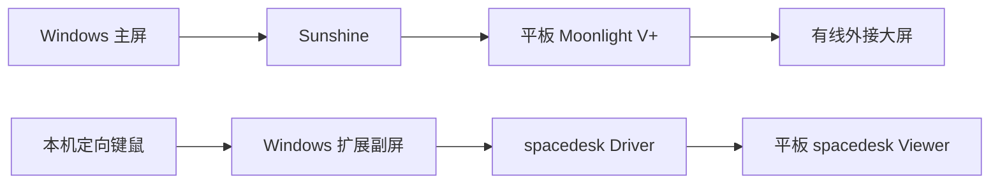

# Windows 平板双屏协作

用一台 Android 平板和一台有线外接显示器，显示同一台 Windows 电脑的主屏和扩展副屏。大屏供本人操作，平板能看到副屏上的 CAD 或其他窗口。四个模块可以单独使用。



## 从需要的模块开始

| 想做到什么 | 指南 | 用到的工具 |
| --- | --- | --- |
| 把 Windows 主屏送到平板连接的大屏 | [01 主屏串流](docs/01-main-screen.md) | Sunshine、Moonlight V+ |
| 把平板作为 Windows 扩展屏 | [02 平板副屏](docs/02-tablet-display.md) | spacedesk Driver、Android Viewer |
| 定向操作另一个窗口，给主屏留出实体键鼠 | [03 独立键鼠](docs/03-independent-input.md) | ProtoInputMultiPlex |
| 核对开机自启、显示状态和连接 | [04 开机与排查](docs/04-startup-and-troubleshooting.md) | Windows 服务、只读检查脚本 |

## 双屏快速上手

1. 电脑和平板连到能互相访问的同一局域网。用支持视频输出的线或扩展坞把平板接到大屏。
2. 在 Windows 启动 Sunshine，在平板用 Moonlight V+ 配对。打开「把串流发送到外接显示器」，后台行为选「保持串流连接」，然后启动 Desktop。
3. 在 Windows 安装 spacedesk Driver，在平板打开 spacedesk Viewer，连接电脑当前的局域网 IPv4。Windows 显示设置选「扩展这些显示器」。此时大屏应显示 Windows 主屏，平板应显示另一个 Windows 桌面区域。
4. 确认两路画面后，再按需要试独立键鼠。用空白图验证目标窗口和按键路由，再转到正式工作。

## 验证进度

| 项目 | 结果 |
| --- | --- |
| Windows 11、小米平板 6S Pro 和有线外接大屏 | 在允许设备互访的校园网上，两路画面已同时显示。平板清理后台后重连也跑通。 |
| 定向键鼠 | 在独立的本机测试中，实体键鼠和副屏测试窗口的输入分开。AutoCAD 中键平移和滚轮缩放、天正空白图画墙已验证。 |
| 两路同时串流时并行操作 CAD | 待日常使用验证，包括把副屏从右侧移到下方后的行为。 |
| 启动和重连 | 核对了 Sunshine 和 spacedesk 的自动启动配置及运行状态。完整的 Windows 重启恢复和笔记本内屏熄灭测试仍待验证。 |
| 跨网 | 两台设备的 Tailscale 网络可达性已检查。跨网视频尚未验证，局域网直连可单独使用。 |

## Windows 只读检查

从仓库根目录运行。脚本检查服务、已监听的常用 TCP 端口和 Windows 识别到的显示器，也可用 `-Component Sunshine` 或 `-Component spacedesk` 单独检查。

```powershell
.\scripts\Test-DualScreenHost.ps1
```

## 许可

仓库原创文档和脚本采用 [MIT](LICENSE)。所提及软件的授权以各自项目或厂商的条款为准。
